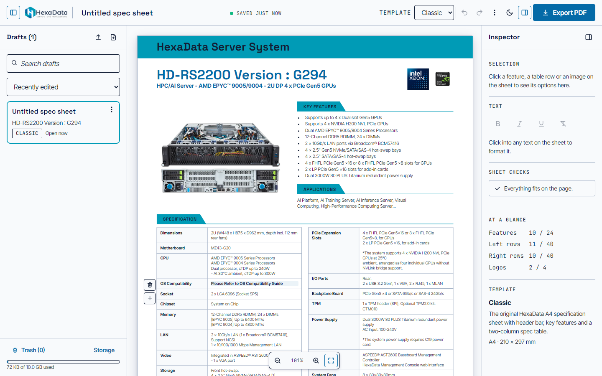

<div align="center">

# HexaData Spec Editor

[](https://github.com/atriganguly/hexadata-spec-editor/actions/workflows/ci.yml)

**Design, save and export HexaData A4 specification sheets.**<br>
Template-driven editor · unlimited local drafts · print-ready PDF · built on the official [HexaData brand system](https://github.com/atriganguly/hexadata-brand).

<picture>
  <source media="(prefers-color-scheme: dark)" srcset="docs/screenshot-dark.png">
  
</picture>

</div>

## What it does

- **Edit the sheet itself.** Click any text on the A4 page and type. Bold, italic and underline, key features and table rows with hover handles, replaceable images, undo/redo, zoom, and automatic extra pages when the specification grows (rows move whole to a continuation page; unused pages disappear; page numbers can be switched off in the Inspector).
- **Pick a template.** A template dropdown in the header; "Classic" (the original HexaData sheet) ships today and new templates are one folder plus one registry line ([docs/templates.md](docs/templates.md)). Switching never deletes content: anything the new template does not show is kept.
- **Drafts, unlimited.** Every edit is autosaved in your browser (IndexedDB). Create, rename, duplicate, search, trash and restore drafts, close the tab and continue any time. Download a draft as a `.hxspec` file (or a backup of all of them) to move between devices.
- **A PDF that matches the screen.** The same React template renders the editor and the PDF, so what you see is what you print (verified pixel by pixel in the test suite). Output is an A4 PDF (one page, or as many as the content needs, up to 8) with embedded brand fonts and real document properties.
- **Fast and light.** Initial JavaScript is about 117 KB gzip, stylesheets 9 KB, no third-party requests, works offline once loaded (PWA). A performance budget gate keeps it that way.
- **Accessible.** Keyboard-complete, WCAG 2.2 AA checked in CI in light and dark themes at phone, tablet and desktop widths.

## Quick start

Requires **Node 26** (`.node-version`; on Windows use [fnm](https://github.com/Schniz/fnm)).

```bash
npm install            # installs everything and downloads the renderer's headless Chrome
npm run dev            # editor on http://localhost:5173, PDF engine on http://localhost:3001
```

| Command                                      | What it does                                                                      |
| -------------------------------------------- | --------------------------------------------------------------------------------- |
| `npm run dev`                                | Web app + PDF server with reload                                                  |
| `npm run check`                              | lint, format, typecheck, unit/integration tests, build, performance budgets       |
| `npm run test:e2e`                           | Playwright against the production builds (`npx playwright install chromium` once) |
| `npm run build`                              | Production builds of the web app and the PDF server                               |
| `npm run smoke -w @hexadata/spec-pdf-server` | Boots the built server and renders a PDF                                          |
| `npm run brand:update -- <version>`          | Replace the vendored `@hexadata/brand` package                                    |

## How it is built

```
apps/web  (React 19, Vite 8, Tailwind 4, zustand + immer, IndexedDB, PWA)
   │  uses                                   │  POST /v1/render  (document JSON + uploaded images)
   │                                         │  POST /v1/layout  (page breaks only, no images)
   ▼                                         ▼
packages/templates  ◄── same component ──►  apps/pdf-server  (Fastify, Puppeteer + chrome-headless-shell)
   │  slots, registry, Classic                  │  validates · sandboxes · renders · stamps PDF metadata
   ▼                                            ▼
packages/core  (content model · rich text · schema · limits · migrations)      @hexadata/brand (vendored)
```

- **Content is data, not HTML.** Rich text is lines of runs with bold/italic/underline marks. One schema validates it in the editor, in `.hxspec` import and on the server. User text can never become markup.
- **One layout authority.** The PDF engine decides where the specification breaks across pages (`POST /v1/layout`, the same measurement the export uses) and the editor shows exactly those breaks, even in a browser that enforces a minimum font size. Offline, the editor falls back to its own estimate.
- **One component, two outputs.** Templates place content only through slots. In edit mode the editor swaps in editable cells; in print mode the server renders the same tree to static HTML for Chrome.
- **Brand-first UI.** Tokens, fonts, logos and `.hd-*` components come from `@hexadata/brand` (light and dark themes included). The printed sheet uses the raw palette as fixed paper; the app chrome uses the contrast-checked roles.

More detail for contributors and agents: [AGENTS.md](AGENTS.md) · [CONTRIBUTING.md](CONTRIBUTING.md) · adding templates: [docs/templates.md](docs/templates.md) · reporting vulnerabilities: [SECURITY.md](SECURITY.md).

## Drafts and your data

Drafts live in **this browser, on this device**, in IndexedDB. The Storage dialog (More → Download backup of all drafts, or the Storage button in the drafts panel) shows usage and lets you ask the browser for persistent storage; browsers decide that request themselves, so a backup remains the reliable safety net. They are not uploaded anywhere; exporting a PDF sends only the sheet being exported (and its uploaded images) to the PDF engine, which does not store it. Clearing site data, private windows or switching browsers removes drafts: use **More → Download backup of all drafts** regularly. Deleted drafts stay in the trash for 30 days. Only one tab edits a draft at a time (the other shows read-only with "Edit here instead").

## Security model

The PDF engine renders user-supplied content in a headless browser, so it is built defensively:

- **No markup injection:** the document is data; every string is escaped by React. Pasted HTML is reduced to bold/italic/underline.
- **No network for the renderer:** the print page has a CSP with `script-src 'none'`, and every browser request is answered from memory or aborted. Internal URLs (`http://169.254.169.254/...`) cannot be fetched even if markup escaped.
- **Strict input validation:** one schema, size limits (JSON 256 KB, 5 MB/image, 20 MB total), uploaded images are re-verified by SHA-256 and header (type and pixel size) before they reach a decoder.
- **Bounded resources:** one shared Chrome, concurrency and queue caps (503 + `Retry-After` when busy), render timeout, browser recycling, graceful shutdown.
- **Origin and rate controls:** exact-origin allow-list (`ALLOWED_ORIGINS`, required in production), per-IP rate limit, Helmet headers, structured errors without internals.
- **Chrome sandbox:** disabled by default on Linux because containers rarely allow it (`CHROME_NO_SANDBOX=0` to enable where supported). The renderer has no network and no scripts, which is the main mitigation.

The service has no user accounts: it is meant for a trusted team behind the origin allow-list. For a public deployment add authentication in front of it.

## Deploying

**Option A: GitHub Pages + Render (default)**

1. Render: create a Blueprint from `render.yaml`. Set `ALLOWED_ORIGINS` to the Pages origin (for example `https://atriganguly.github.io`). The service URL is `https://hexadata-spec-editor.onrender.com` unless you rename it.
2. GitHub: Settings → Pages → Source = **GitHub Actions**. Optionally set the repository variable `PDF_API_URL` if the engine URL differs.
3. Merge to `main`: CI runs, then `pages.yml` publishes the editor and Render redeploys the engine.

Render's free tier sleeps after inactivity. The editor wakes it when the app opens, and the first export shows "Waking PDF engine…".

**Option B: one container (UI and API on the same origin, no CORS)**

```bash
docker build -t hexadata-spec-editor .
docker run --rm -p 8080:8080 hexadata-spec-editor        # http://localhost:8080
```

Behind a reverse proxy set `-e TRUST_PROXY=1` so rate limits see client IPs.

### Server configuration

| Variable                 | Default            | Meaning                                                                        |
| ------------------------ | ------------------ | ------------------------------------------------------------------------------ |
| `PORT` / `HOST`          | `3001` / `0.0.0.0` | Listen address                                                                 |
| `ALLOWED_ORIGINS`        | dev origins        | Comma-separated exact origins. **Required in production** unless `SERVE_WEB=1` |
| `SERVE_WEB` / `WEB_DIST` | off                | Serve the built web app from the same process                                  |
| `RENDER_CONCURRENCY`     | `2`                | Renders at once (each is a browser tab, 80-150 MB). Use `1` on 512 MB hosts    |
| `RENDER_QUEUE_MAX`       | `8`                | Waiting renders before answering 503                                           |
| `RENDER_TIMEOUT_MS`      | `20000`            | Per-render limit (504)                                                         |
| `BROWSER_RECYCLE_AFTER`  | `200`              | Restart Chrome after N renders                                                 |
| `RATE_LIMIT_MAX`         | `30` per minute    | Per-IP render limit (`RATE_LIMIT_WINDOW_MS` sets the window)                   |
| `TRUST_PROXY`            | `false`            | Proxy hops (`1`, `true`) when behind a reverse proxy                           |
| `CHROME_NO_SANDBOX`      | on for Linux       | See the security model                                                         |
| `WARM_ON_BOOT`           | `1`                | Launch Chrome at start-up so the first export is fast (`0` to launch lazily)   |
| `LOG_LEVEL`              | `info`             | `trace` … `fatal`, `silent`                                                    |

The web app reads `VITE_API_BASE_URL` at build time (empty = same origin).

## Troubleshooting

- **"The PDF engine could not be reached"**: the server is not running (dev: `npm run dev`), the URL is wrong (`VITE_API_BASE_URL`), or a free-tier host is waking up (retry after a minute).
- **"This site is not allowed to use the PDF engine"**: add the app's exact origin to `ALLOWED_ORIGINS`.
- **"The sheet needs N pages; the limit is 8"** (or "A specification row is taller than a page"): shorten the specification text or remove rows. The Inspector's "Sheet checks" shows the current page count.
- **Drafts vanished**: site data was cleared or you are in a different browser/profile. Restore from a backup via **Import**.
- **Chrome not found when starting the server**: run `npm install` again, or `npx puppeteer browsers install chrome-headless-shell`.
- **`Chrome` crashes in a container**: keep `CHROME_NO_SANDBOX=1` and give the container at least 512 MB.

## Licence

The software in this repository is the work of Esconet Technologies Limited. The **HexaData brand assets** (name, logos, taglines, the vendored `@hexadata/brand` package, shipped partner and product images) are trademarks and proprietary material, not open source; see the brand package's `BRAND-LICENSE.md`. Fonts (Space Grotesk, Inter Tight, JetBrains Mono) are under the SIL Open Font License 1.1.
